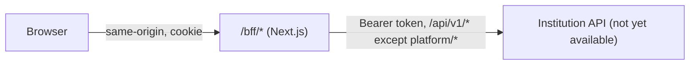

# edulynk-erp-web

The Edulynk institution ERP web application (tenant realm, data plane). It reuses the Business Portal's Next.js and
TypeScript foundation: sealed session cookie, CSP nonce proxy, same-origin BFF, API client, error envelope, UI
primitives, and the lint, test and accessibility tooling.

It is deliberately separate from platform administration:

- **Auth realm:** tenant realm only. The session cookie (`__Host-edl_erp_session`) is distinct from the Business
  Portal's, principals must have `realm: 'tenant'` and a `tenantId`, and platform principals are treated as signed out.
- **API access:** the BFF forwards only to `${TENANT_API_BASE_URL}/api/v1/*` and refuses `platform/*` paths. The
  tenant is never sent from the browser; the upstream derives it from the verified token.
- **Branding:** institution white-label tokens (name, primary colours) are validated and applied through a nonce'd
  style. Until the branding contract exists, every request uses the neutral Edulynk default.

There is no fake data. Sign-in is unavailable (`unconfigured` adapter) until the tenant-realm identity contract is
approved, so no authenticated page can be reached yet, and no institution modules exist in the navigation.



## Local development

Requires Node 22 (`nvm use`).

```sh
npm ci
cp .env.example .env.local                                    # never commit .env.local
openssl rand -base64 32                                       # paste into SESSION_ENCRYPTION_KEY in .env.local
npm run dev                                                   # http://localhost:3000
```

| Variable                       | Required | Notes                                                                  |
| ------------------------------ | -------- | ---------------------------------------------------------------------- |
| `APP_ENV`                      | yes      | `development`, `test`, `staging` or `production`                       |
| `SESSION_ENCRYPTION_KEY`       | yes      | Base64 of 32 random bytes                                              |
| `AUTH_ADAPTER`                 | no       | `unconfigured` (only value)                                            |
| `TENANT_API_BASE_URL`          | no       | Institution API origin; `https` in staging/production. Unset: BFF 503. |
| `API_TIMEOUT_MS`               | no       | Default 10000                                                          |
| `SESSION_REFRESH_SKEW_SECONDS` | no       | Default 60                                                             |

## Validation

```sh
npm run format:check
npm run lint
npm run typecheck
npm test              # Vitest: unit (node) and component (jsdom) projects
npm run build
npm run test:e2e      # Playwright against a production-mode build; run `npx playwright install chromium` once
npm run ci            # all of the above
```

## Container image

```sh
docker buildx build --platform linux/arm64 \
  --build-arg NODE_IMAGE=<digest-pinned Node 22 slim image> -t edulynk-erp-web:local .
```

`NODE_IMAGE` has no default (owner input required). The image runs as UID/GID 1000 and contains no credentials.

## Known issues

- `npm audit` reports 5 **high** findings, all one advisory: `braces` stack-exhaustion DoS
  ([GHSA-vfj7-8cjw-p6xm](https://github.com/advisories/GHSA-vfj7-8cjw-p6xm)), path
  `eslint-config-next → @next/eslint-plugin-next → fast-glob → micromatch → braces`. No patched `braces` release
  exists; the only automated "fix" is a major downgrade to `eslint-config-next@14`. It is dev-only and reachable only
  through glob patterns in lint configuration. `npm audit --omit=dev --audit-level=high` is clean. Not suppressed;
  revisit when an upstream fix ships.

## Status

- **Unresolved, not implemented:** tenant-realm identity contract (sign-in, token claims, roles), institution
  resolution for branding (domain, subdomain or tenant), institution API path layout and gateway, institution modules.
- **Not copied from the Business Portal:** platform navigation, platform roles and grants, the development
  fixture-persona adapter, data-table and form components (added back when a module needs them).
